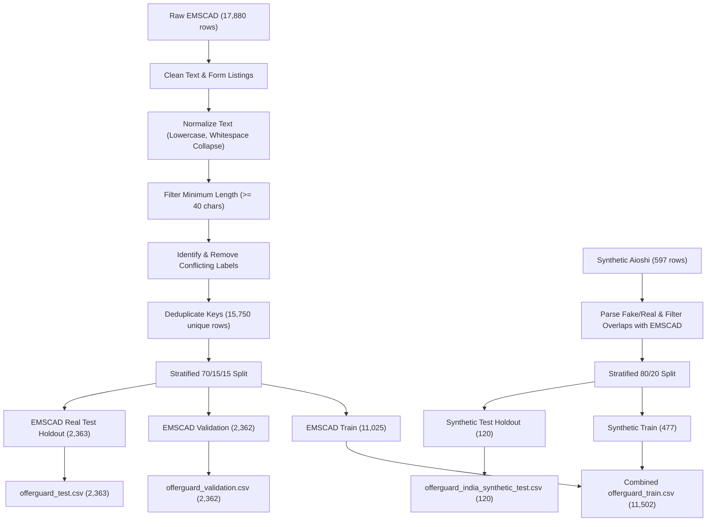

# OfferGuard India: Dataset Provenance & Data Hygiene

This document provides complete documentation of the data sources, preprocessing steps, leakage prevention mechanisms, and split statistics for the OfferGuard India platform.

---

## 1. Data Sources

### A. EMSCAD (Employment Scam Aegean Dataset) — Real-World Postings
- **Origin**: University of the Aegean / Kaggle (`shivamb/real-or-fake-fake-jobposting-prediction`).
- **Raw Row Count**: 17,880 job advertisements.
- **Raw Class Distribution**:
  - `fraudulent = 0` (Legitimate): 17,014 (95.16%)
  - `fraudulent = 1` (Fraudulent): 866 (4.84%)
- **Feature Extraction**:
  The following five textual columns are merged into structured listings:
  1. `title`
  2. `company_profile`
  3. `description`
  4. `requirements`
  5. `benefits`
  Each field is truncated to 850 characters, and the composite listing is capped at 3,300 characters.

### B. `Aioshi/smolified-fakejob` — Indian-Context Synthetic Data
- **Origin**: Hugging Face dataset `Aioshi/smolified-fakejob`.
- **Raw Row Count**: 597 dialogue examples (`system`, `user`, `assistant`).
- **Nature**: Handcrafted synthetic scenarios modeling Indian recruitment fraud vectors (e.g. registration fees in INR, WhatsApp recruitment redirection, task-based scams, free webmail impersonating HDFC, Amazon, etc.).
- **Label Extraction**:
  - Regex parser: `(?i)Classification:\s*(Fake|Real)`
  - `Fake` mapped to `1` (FRAUDULENT) (373 samples)
  - `Real` mapped to `0` (LEGITIMATE) (224 samples)
- **Important Ethical & Scientific Distinction**:
  This dataset is **explicitly classified as synthetic**. In accordance with hackathon guidelines, it is **never** presented as genuine real-world recruitment data. Its test split is evaluated and reported separately from the real EMSCAD holdout.

---

## 2. Data Cleaning & Leakage Prevention Protocol

To ensure strict scientific reproducibility and prevent optimistic evaluation bias, the following steps were executed in `ml/prepare_data.py`:

### Verification Checks:
1. **Zero Text Leakage**: The overlap between training instructions and test instructions is exactly $0$.
2. **Zero Contradictory Labels**: Advertisements appearing with both `fraudulent=0` and `fraudulent=1` were eliminated before splitting.
3. **Holdout Isolation**: Neither `offerguard_validation.csv` nor `offerguard_test.csv` nor `offerguard_india_synthetic_test.csv` are ever combined with training data or used for data augmentation.

---

## 3. Dataset Split Counts Summary

| Dataset Split File | Provenance | Total Rows | Legitimate (0) | Fraudulent (1) | Fraud Prevalence |
| :--- | :--- | :---: | :---: | :---: | :---: |
| **`offerguard_train.csv`** | EMSCAD Train (11,025) + Aioshi Train (477) | **11,502** | 10,706 | 796 | 6.92% |
| **`offerguard_validation.csv`** | EMSCAD Validation (Real-World) | **2,362** | 2,255 | 107 | 4.53% |
| **`offerguard_test.csv`** | EMSCAD Test (Real-World Holdout) | **2,363** | 2,256 | 107 | 4.53% |
| **`offerguard_india_synthetic_test.csv`** | Aioshi Test (Synthetic Holdout) | **120** | 45 | 75 | 62.50% |
| **Total Processed** | | **16,347** | **15,262** | **1,085** | |

