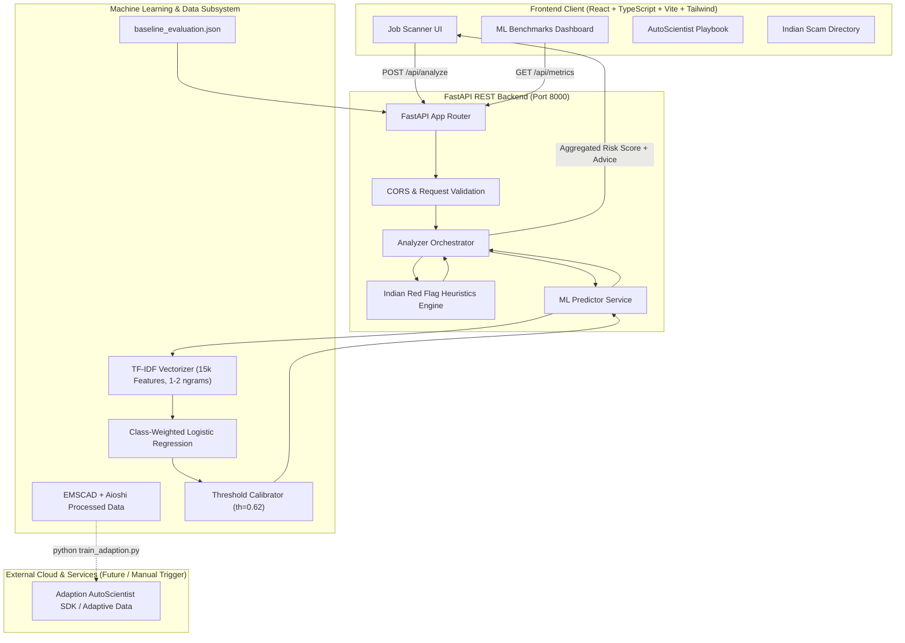

# OfferGuard India: System Architecture

OfferGuard India is an AI-powered recruitment fraud and job phishing detection platform designed specifically to safeguard Indian job seekers against advance-fee scams, task frauds, and credential harvesting.

---

## 1. High-Level Architecture Diagram

---

## 2. Component Breakdown

### A. Frontend Layer (`frontend/`)
- **Tech Stack**: React 19, TypeScript, Vite, Tailwind CSS v4, Lucide React.
- **Interactive Capabilities**:
  - **Live Job Scanner**: Accepts pasted job advertisements, email transcripts, and SMS/WhatsApp messages.
  - **Risk Gauge**: Real-time 0–100 risk score with dynamic risk bands (`LOW`, `MODERATE`, `HIGH`, `CRITICAL`).
  - **Red Flag Explanations**: Categorized risk indicators highlighting monetary demands, communication redirection, free webmail domains, and task scams.
  - **Indian Regulatory Safeguards**: Direct links to National Cyber Crime Helpline (1930), Cybercrime.gov.in, and MCA21 corporate verification.
  - **Benchmark Inspector**: Transparent confusion matrix, threshold tuning curves, and dataset split breakdown.
  - **AutoScientist Playbook**: Step-by-step interactive launch guide with `--check-only` verification.

### B. Backend API Layer (`backend/`)
- **Framework**: FastAPI with asynchronous endpoints and Pydantic v2 schemas.
- **Key Modules**:
  - `analyzer.py`: Combines continuous ML model probabilities with rule penalties to form the final calibrated risk tier.
  - `red_flag_rules.py`: Regex pattern matcher targeting Indian scam vectors (e.g. INR registration charges, gate pass fees, Telegram task schemes).
  - `predictor.py`: In-memory inference using fitted `joblib` artifacts with sub-millisecond latency.
  - `router.py`: REST routes for single analysis, batch processing, sample presets, and benchmark metrics.

### C. ML & Data Subsystem (`ml/` & `OfferGuard_India/`)
- **EMSCAD Real Data**: 17,880 records cleaned, normalized, deduplicated, and split into 70% Train, 15% Validation, and 15% Test.
- **Aioshi Synthetic India Data**: 597 examples parsed from `Classification: Fake/Real` format and split 80% Train, 20% Test. Synthetic test data is isolated from real EMSCAD test data.
- **Model Baseline**: TF-IDF (15,000 features, unigram + bigram, sublinear TF) + Logistic Regression with `class_weight='balanced'`.
- **Adaption AutoScientist Starter**: Ready-to-upload `offerguard_train.csv` and SDK orchestration script `train_adaption.py`.

